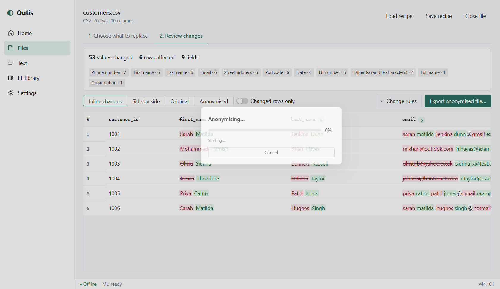
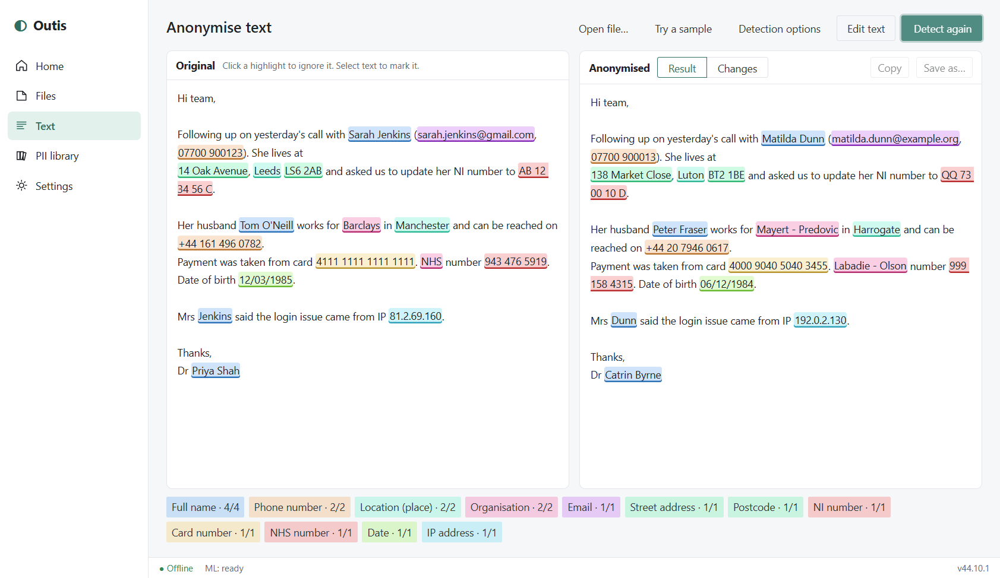
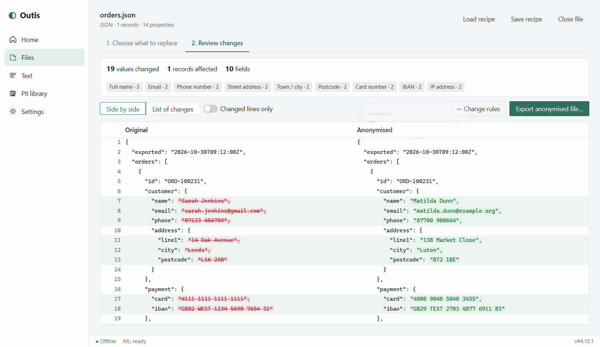

# Outis

**Offline desktop tool for removing personal data (PII) from CSV, JSON and free text.**

Outis runs entirely on your computer. It never connects to the internet: every network request is blocked, and the ML model it uses for names and places ships inside the app.



## What it does

- **CSV and JSON files.** Choose what to do with each column or property path: replace it with a realistic fake, mask it, hash it, redact it, blank it, or scan it as free text. Outis suggests a rule for every field from its name and sample values.
- **Free text.** Paste or open text. Rules find emails, phone numbers, postcodes, NI and NHS numbers, cards, IBANs, IPs, dates and addresses. A local ML model (BERT NER) finds names, places and organisations. Click a highlight to ignore it, or select text to mark it yourself.
- **Consistent fakes.** The same input always gives the same fake, across files and sessions. Names are mapped word by word, so `Sarah Jenkins`, `Mrs Jenkins` and `sarah.jenkins@gmail.com` become, for example, `Emily Lewis`, `Mrs Lewis` and `emily.lewis@example.org`.
- **Safe fake values.** Phone numbers come from Ofcom's drama ranges, emails use reserved domains (`example.com`, `*.example`), NI numbers use the never-issued `QQ` prefix, NHS numbers the `999` test range, and IPs the documentation ranges. Fakes still pass format checks (Luhn, mod-11, mod-97).
- **Customisable PII library.** Edit the names, towns, streets, email domains and phone formats used for fakes. Add your own regex detectors, and words to always or never treat as PII.
- **Compare.** See every change before you export: inline before→after, side by side, or each version on its own. JSON gets a line-by-line diff and text an inline diff.
- **Recipes.** Save the rules for a file layout and reuse them next time.

| Free text                     | JSON                          |
| ----------------------------- | ----------------------------- |
|  |  |

## Install

Download the latest release from the [Releases page](https://github.com/alwynthomasdev/outis/releases):

- `Outis-x.y.z-setup.exe` is the Windows installer.
- `Outis-x.y.z-portable.exe` is a single file that needs no install.

The builds are not code-signed yet, so Windows SmartScreen may warn "Windows protected your PC". Choose **More info → Run anyway**.

## Quick start

1. **Files → Choose a file…** (or drag one in).
2. Check the suggested rule for each column. Change any you like.
3. Press **Anonymise →** and review the highlighted changes.
4. Press **Export anonymised file…**. The original is never modified.

For text, open **Text**, paste something (or **Try a sample**), and press **Find PII →**.

Full guide: [docs/user-guide.md](docs/user-guide.md).

## Documentation

- [User guide](docs/user-guide.md): every screen and option
- [Recipes and JSON paths](docs/recipes.md)
- [Detectors](docs/detectors.md): what is found, and how
- [PII library](docs/library.md): customising fakes and detection
- [Architecture](docs/architecture.md): how it works and how it stays offline
- [Development](docs/development.md): build, test, debug (F5) and release
- [Changelog](CHANGELOG.md)

## Limits

Automatic detection is a help, not a guarantee. Always review the result before sharing data. The ML model is trained on English news text, so it is less reliable on other languages, lower-case text and unusual names. Indirect identifiers (job title + town + age, for example) are not detected. Consider removing or generalising those columns yourself.

## Building from source

```bash
npm install
npm run fetch-model   # downloads the ~110 MB NER model once (needs internet)
npm run dev           # or press F5 in VS Code
```

See [docs/development.md](docs/development.md).

## Licence

[MIT](LICENSE). The bundled NER model, [Xenova/bert-base-NER](https://huggingface.co/Xenova/bert-base-NER) (based on [dslim/bert-base-NER](https://huggingface.co/dslim/bert-base-NER)), is MIT licensed.

The name: Outis ("Nobody") is the name Odysseus gave the Cyclops.
